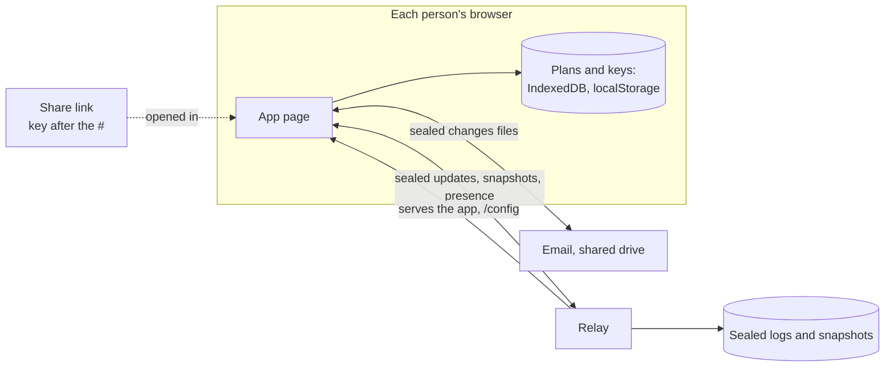

# Threat model: what a relay's operator can and can't do

Planning Board claims that whoever runs a relay can never read the plans that pass through it. This document tests that claim. It treats the operator as the attacker, lists everything they control, and says, for each part of the claim, how it's established: proved, model-checked, argued, or accepted as a limit. It also says where the claim doesn't hold today.

It's written for anyone deciding whether to trust a relay with a plan: a security reviewer at a company, someone running a relay, or the project itself, which runs the public demo relay.

## In short

**What an operator can't do, if the app didn't come from them:**
- Read a plan's content: card titles, descriptions, values, links, names, history, or who's pointing at what.
- Change a plan, or pass one message off as another, without any link to the plan. With a Can view link, they can write (below).

**What an operator can do:**
- **See metadata:** which plans exist, who connects, from which address, when, and how large each change is.
- **Hold back changes,** from everyone or from some people, without anyone being told.
- **Shift the times** history shows, within what their clock claims.
- **Write to a plan,** if they also hold its Can view link. A Can view link is meant to read only.
- **Read everything, through the app they serve,** if people open the app from their relay. This is the largest gap, and it's open (see [Code](#code-the-app-itself)).
- **Restore an old backup.** Started once with `-restored` afterwards, the relay gives every plan a new epoch, and browsers send what the backup lacks. Without it, a browser notices only while the restored relay is behind its cursor. Once others' changes have taken the relay past that point, a browser can go on believing the relay holds changes the backup lacks, so those changes never reach anyone else. A draft of the sync model finds this in seconds.

## The system

- **A link** carries the room and a 32-byte secret `S` (Can edit), or the encryption key `K` alone (Can view), after the `#`. Browsers never send the fragment to a server.
- **From `S`,** HKDF-SHA256 derives `K` and the write token `T`. Nothing derives `T` from `K`.
- **Every message is sealed** with XChaCha20-Poly1305 under `K`, with a fresh random 192-bit nonce. The additional data binds the room, the kind of message (update, snapshot, presence, changes file, history file), and a snapshot's reach (`upto`).
- **The relay** numbers, stores and forwards sealed messages. It accepts writes only from connections that present `T`, whose SHA-256 it keeps. It also serves the app and `/config`, which tells the app the address to put in share links.
- **History** has a room of its own, `<room>_h`, under the same keys. The room name in the additional data keeps the two apart.

How the keys and links work: [ADR 0018](../decisions/0018-keys-and-links.md). The relay: [ADR 0017](../decisions/0017-relay-and-sync.md) and [`relay/PROTOCOL.md`](../../relay/PROTOCOL.md).

## Attackers

| Attacker | What they control | What they don't have |
|---|---|---|
| **The operator** (the main one) | Everything the relay stores and sends: frames dropped, delayed, reordered, replayed or made up; sequence numbers, receive times, epochs, `synced`, `/config`, retirement, backups. They see `T` on every connection that can write. They may serve the app. | `S` and `K`, unless they're given a link |
| **The network,** on plain http | The same as the operator for anything not sealed, including the app's code when it's served over http | `S` and `K` |
| **Someone with a Can view link** | `K` | `S` and `T` |
| **Someone with a forwarded changes file** | A sealed file | Any key |
| **Another page in the same browser origin** | The plan list and every plan in that origin's storage | Nothing more is needed |

Editors aren't attackers here. Anyone with a Can edit link can change anything, and names are self-chosen. Attribution is a courtesy, not an audit trail.

## What's protected

- **Plan content:** cards, values, properties, links, the plan's name, history entries with their names, and presence.
- **Keys:** `S`, `K` and `T`.
  - `S` and `K` are in links, in the plan list (localStorage), and in nothing the relay sees.
  - `T` goes to the relay on every connection that can write.
  - Changes files carry no key.

## Assumptions

Everything below rests on these. None of them is checked here.

- **The primitives:** XChaCha20-Poly1305 is a secure AEAD, HKDF-SHA256 behaves as a random function, and the browser's `crypto.getRandomValues` is unpredictable. The protocol model treats them as ideal, so it proves the protocol uses them correctly, not that they're unbroken.
- **Yjs merges correctly:** any set of changes merges to the same document in any order, any number of times. Its authors argue this for the algorithm _(recalled)_. It isn't verified here, and the sync and tree models treat it as a black box that merges by union. A green CI run is no evidence about Yjs itself.
- **The libraries are what they say:** `@noble/ciphers` and `@noble/hashes` implement the primitives, and the build bundles the versions in `package-lock.json`.
- **The browser keeps origins apart,** and nothing else runs in the app's origin (but see F3 and F8).

## The claims, and how each is established

| # | Claim | How | Status |
|---|---|---|---|
| C1 | The operator can't learn a plan's content from anything the relay stores or forwards | **Proved** by the protocol model: secrecy of content and of `K`, against an attacker who controls the network and holds `T` | Pending: the protocol model |
| C2 | The operator can't make a client accept a message that someone holding `K` didn't seal for that room and kind, nor an old snapshot as a newer one | **Proved:** correspondence, from the additional data | Pending: the protocol model |
| C3 | Presence can't be passed off as a change, nor history as the board | **Proved:** the kind and room are in the additional data | Pending: the protocol model |
| C4 | A Can view link can't write, if the relay is honest | **Checked** by the sync model, and tested in Go | Tested; model pending |
| C5 | A retired room accepts no write, and old links can't reach the new room | **Checked** by the sync model, and tested | Tested; model pending |
| C6 | With an honest relay, nothing acknowledged is lost, and everyone who reconnects converges, offline work included | **Checked** by the sync model, and tested against the real code with random schedules | Pending |
| C7 | Grouping never makes a cycle, even when two people nest cards at once | **Checked** by the tree model | Pending |
| L1 | Write enforcement trusts the relay | **Accepted limit.** An operator holding a Can view link can write. Signing each change would close this. | Accepted |
| L2 | The operator can hold back changes without anyone knowing | **Accepted limit** (see F4) | Accepted |
| L3 | Metadata is visible | **Accepted limit** | Accepted |
| L4 | Code served by the relay can read everything | **Open** (see [Code](#code-the-app-itself)) | Open: see F2 |

Each pending entry becomes **Proved** or **Checked** when its model runs in CI, alongside the code it describes.

## Code: the app itself

A relay that serves the app can serve an altered one, which reads the key from the link and sends it, or the plan, anywhere. No proof about the protocol reaches this. Today:

- **The relay always serves the app.** There's no setting that stops it.
- **Links send people to the relay's own copy of the app,** unless the page and the relay are both https. So every pilot on a laptop, and most self-hosted relays, depend on trusting whoever runs the relay.
- **A page can't check itself.** An altered app would show the real build's hash.
- **The app's HTML has no published checksum or attestation.** Only the relay downloads do.

## Findings

| # | Finding | Severity | Plan |
|---|---|---|---|
| F1 | **`/config` decides where links open the app,** even when sharing from the public build. If a relay reports an `http` address, links send everyone to the relay's own copy of the app, which the operator controls. A relay behind an https proxy, started with neither `-public-url` nor `-trust-forwarded`, reports `http` by mistake, so even an honest relay can do it. | High, for any https relay | **Being fixed:** links keep the page they were made on whenever the relay the sharer chose is https, whatever `/config` says |
| F2 | **Code served by the relay** (above) | High where the app comes from the relay | **Being decided.** Whatever the answer, the hosted demo relay serves no app. |
| F3 | **Every site under `zjs.github.io` shares one browser origin** with the public build, so any of them could read its plans and keys | Medium: today they're all the same publisher's, but each brings its own code | **Proposed:** move the public build to an origin of its own, a domain of its own, before the demo relay invites strangers |
| F4 | **Holding back is silent.** The relay can withhold changes, show people different versions, or label a change with a later number so a client never asks for the ones in between, while the pill says Live | Medium: integrity, not secrecy | **Accepted for now.** Signed sequence heads, or a hash chain over changes, would let clients notice. Queued in the backlog. |
| F5 | **An operator with a Can view link can write** (L1) | Low for the demo relay, whose links nobody shares with the operator | **Accepted;** signing each change is queued |
| F6 | **History times follow the relay's clock** when an author's is off by more than a minute, so an operator can misdate entries | Low | **Accepted** |
| F7 | **No forward secrecy.** The relay keeps sealed content for as long as it keeps the room, which today is forever, so a link leaked later reveals the whole plan, deleted cards and history included. Making new links doesn't change what old links can read. | Medium | **Accepted.** The demo relay will delete plans left idle for 30 days, and its privacy note will say so. |
| F8 | **In Chromium-based browsers, every page opened from disk shares one browser storage,** so any HTML file someone opens locally can read the plans and keys of the app opened from disk. Firefox gives each file its own _(recalled)_; Firefox and Safari are still to be checked. | Medium, and it weighs on F2: one way to keep a laptop relay out of the code has people open the app from disk | **Weighed with F2** |
| F9 | **A share link is a password,** and it can end up in browser history and in history synced to a browser account. The app takes the key out of the address bar once it's saved. | Low | **Accepted** |
| F10 | **A first catch-up cut short could miss changes after a restore.** A browser opening a link for the first time takes the epoch from the relay's last message. If the connection drops before that message, and the relay is then restored from a backup, the browser reconnects with a cursor from the old room and never fetches the new room's first changes. Found by the first run of a draft of the sync model, and confirmed by reading `src/store/relay.ts`. | Medium: rare, and silent | **Being fixed,** with the model: a cursor with no epoch starts again from nothing |

## Metadata the operator sees

Room IDs, and how many plans there are. Which addresses connect, when, how often, and for how long. How large each change, snapshot and presence message is, which hints at how much a plan moved and how many people are pointing at things. Whether a connection can write. When links were replaced. None of it names a card, a person or a plan.

## What the formal models cover, and what they don't

The models are being written now, and land in the repository with the slices that build them; until then the paths below are where they'll live, and the claims table says which have run. The results quoted in this document (F10, and the restore without `-restored`) come from local drafts.

- **The protocol model** (to live in `formal/proverif/`) covers key derivation, sealing with additional data, Can edit and Can view links, write tokens, and Make new links, against an attacker who is the network plus the relay.
- **The sync model** (to live in `formal/tla/Sync.tla`) covers the relay's log, snapshots, compaction, retirement, epochs and restores, and each client's document, shadow, cursor and resends. It includes going offline, crashing mid-save, reloading and the relay restarting.
- **The tree model** (to live in `formal/tla/Tree.tla`) covers concurrent moves and loop repair.
- **Random schedules** (to live in `e2e/relay/schedules.spec.ts`) run the real app and relay through offline work, reloads, restarts and restores, and check the sync model's properties on what actually happened.

Not covered: the browser and its storage, the cryptographic primitives themselves, side channels, denial of service, and anyone who already has a link.
